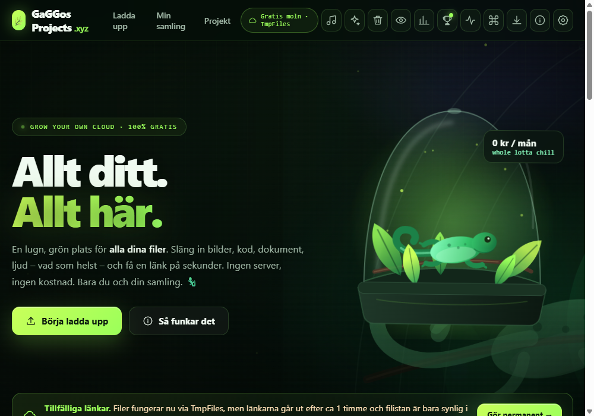

<div align="center">

# 🌿 GaGGos Projects

**Din gröna drop för allt.** Ladda upp filer, få länkar på sekunder och odla en samling som faktiskt stannar kvar.

[](https://gaggo-projects.netlify.app)
[](https://thashamans-hub.github.io/gaggo-projects/)
[](https://github.com/thashamans-hub/gaggo-projects)



**🔗 [Öppna sajten på Netlify](https://gaggo-projects.netlify.app) · [Öppna GitHub Pages-versionen](https://thashamans-hub.github.io/gaggo-projects/) · [Ladda ner ZIP](https://github.com/thashamans-hub/gaggo-projects/archive/refs/heads/main.zip)**

</div>

---

## ✨ Vad det är

En **statisk, episk filhostnings-sida** byggd i ren HTML/CSS/JS – ingen build, inga npm-beroenden för drift. Mörk terrarie-estetik med glödande sporer, glasspaneler och en lizard som hänger på väggen. 🦎

| Egenskap | Beskrivning |
|---|---|
| 📤 Uppladdning | Dra & släpp filer eller hela mappar, klistra in från urklippet, eller ladda upp från URL |
| 🔗 Riktiga länkar | TmpFiles (gratis, inget konto) med **automatisk förnyelse** var 50:e minut |
| ♾️ Permanent | Catbox, Supabase eller Cloudinary – välj i inställningarna |
| 🗂️ Filhanterare | Grid/lista, förhandsvisning, taggar, anteckningar, stjärnor, fästa filer, papperskorg |
| 🔍 Sök | `tag:`, `folder:`, `type:`, `ext:`, `content:`, `starred` + fuzzy-match |
| ⌘ Kommandopalett | `Ctrl/Cmd+K` – 20+ kommandon, senaste använda överst |
| 📦 Export | ZIP-backup, CSV, markdown-länkar och fristående delningssida |
| 📊 Insikter | Lagringsdonut, 7-dagarsdiagram, värmekarta, systemstatus, XP och 17 badges |
| 🎧 Chill | Ambient-ljud, roterande bakgrunder, zen-läge och egna accentfärger |
| 📱 PWA | Installerbar, offline-shell, service worker |

## 🚀 Kom igång

```powershell
# Öppna bara filen – eller starta den inbyggda servern
cd site
node serve.js 8080     # http://localhost:8080

# Testa
npm test               # 16 tester, 0 beroenden
```

Eller ladda ner färdig ZIP från skrivbordet/`INSTALL.md` och dra in den på [Netlify Drop](https://app.netlify.com/drop).

## 🌐 Publicering

- **Netlify:** [gaggo-projects.netlify.app](https://gaggo-projects.netlify.app) – aktiv med `_redirects`-proxy.
- **GitHub Pages:** [thashamans-hub.github.io/gaggo-projects](https://thashamans-hub.github.io/gaggo-projects/) – byggs automatiskt vid push till `main`.
- **Egen domän:** lägg till ett `CNAME` eller ställ in custom domain i Netlify.

## 💾 Lagring

| Läge | Konto | Giltighet | Delas |
|---|---|---|---|
| TmpFiles (standard) | Nej | Förnyas automatiskt | Nej |
| Catbox | Nej | Permanent | Nej |
| Supabase | Ja, gratis | Permanent | **Ja** |
| Cloudinary | Ja, gratis | Permanent | Nej |

För en **riktigt delad** webbplats där alla besökare ser samma filer: följ [`ANSLUT.md`](ANSLUT.md) och kör [`supabase-setup.sql`](supabase-setup.sql) i Supabase SQL Editor – klistra sen in URL + anon-nyckel i sajtens inställningar.

## 📚 Dokumentation

- [`SETUP.md`](SETUP.md) – installation, moln, felsökning
- [`REQUIREMENTS.md`](REQUIREMENTS.md) – krav och begränsningar
- [`ANSLUT.md`](ANSLUT.md) –Supabase på 3 minuter
- [`supabase-setup.sql`](supabase-setup.sql) – färdig SQL

---

<div align="center">

Gjort med 🌿, kaffe och alldeles för många tabs.

**GaGGo** · [GitHub](https://github.com/thashamans-hub/gaggo-projects) · [Live](https://gaggo-projects.netlify.app)

</div>
